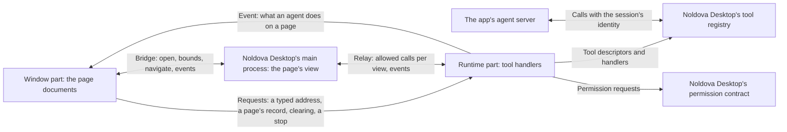

# Architecture

**Scope:** Browser's two forms, its packages and the process each part runs in, the page documents' layout and layering, profile isolation, the agent tools and how they reach agents, and what Browser needs from Noldova Desktop.
Risk levels, permission requests, the URL policy and the threat model are in [SECURITY-MODEL.md](SECURITY-MODEL.md).

This document gives the design.
**Not yet** marks what isn't built, which mostly waits for Noldova Desktop, as [section 9](#9-what-browser-needs-from-noldova-desktop) lists, or for a decision, as [section 10](#10-open-boundaries) lists.

## 1. Browser

Browser shows web pages as documents in the window of an app built on Noldova Desktop, and lets the app's agents drive them.
It has three parts:

- **The pages:** documents in the app's window, where a person browses and watches what an agent does.
- **The agent tools:** navigate, read, click, type, screenshot and console reading, which the module registers with Noldova Desktop's tool registry and the app serves to its agents.
- **The permission requests:** each action that needs the person's approval raises a request through Noldova Desktop's permission contract.

The runtime part registers the eight tools with Noldova Desktop's tool registry, and each that may change the page raises its requests through Noldova Desktop's permission contract, as [section 7](#7-agent-tools) says.

The module owns its actions and their risk levels.
The app owns the permission card, its policy, the agents and how they reach the tools.

The module is product-neutral: an app configures it through its published API, and the module holds no app's names, text or behavior.
Where a text names the app, the module reads the name at run time from the build's product file, through Noldova Desktop.

## 2. Two forms

Browser is one module, `browser`, delivered in two forms from this repository.

| Form | What it is | Who gives the identity and the agents |
|---|---|---|
| The module | The packages of section 3 and the module's declaration, which an app on Noldova Desktop lists among its modules | The app that includes it |
| The Browser app | An app on Noldova Desktop whose only module is `browser`, built, packaged and released from this repository | This repository's root `package.json`, under `desktop` |

- Both forms run the same packages; the app form adds no code to the module and the module never knows which form it runs in.
- The module declares itself in `src/noldova.browser/module.json` with the fields Noldova Desktop's module contract sets: `id` is `browser`, its `parts` are `runtime` and `window`, and it has no module dependencies, an empty `dependencies` object.
- The app form's root `package.json` gives the app's identity and lists `browser` as its one module, as Noldova Desktop's build reads them.
  **Not yet:** the root `package.json` has no `desktop` section; the app's identity isn't chosen yet, and the app needs Noldova Desktop's packages and app tooling published.
- An app includes the module by listing it in `desktop.modules` as `{ "id": "browser", "package": "@noldova/browser" }` and pinning that package to an exact version, as Noldova Desktop's MODULES.md says under "Modules from packages"; the package exports its parts as `@noldova/browser/runtime` and `@noldova/browser/window`.

## 3. Packages

The module ships its own npm package, which holds the runtime part and re-exports the window part, one package for the window part, and one for the messages between them.
The module package keeps its sources in `src/noldova.browser/src` and its tests in `src/noldova.browser/tests`, as the other two do; its entries are in `src/api`: `index.ts`, the runtime part, and `window.ts`, which passes the window package on.

| Package | Holds | Depends on today |
|---|---|---|
| `@noldova/browser.protocol` | The tool names, a model class for each message the two parts exchange, the requests, the answers, the activity and the shapes in them, each written by its `toJson` and read by its `fromJson`, which refuses a malformed one with a `JsonException` naming the field's path, and the rules both parts read alike: what kind of address a URL's host is, and which sites Sites on this computer or network names | as peers context's `@noldova/context.json`, which reads the messages, and `@noldova/context.exceptions`, whose `ArgumentException` its models throw, at `>=0.0.7 <0.1.0` |
| `@noldova/browser` | The runtime part, `RuntimePart`, and what it runs each call through: the tool descriptors, the input checks, the permission gate, the risk classifier, the pane's queue, the allowlist of calls on the view, the results and failures, and each workspace's allowed origins, which it keeps in its database | `@noldova/browser.protocol` and `@noldova/browser.window` at its own version, 0.0.4, and as peers Noldova Desktop's protocol and runtime packages, at `module.json`'s `noldovaDesktop`, `>=0.0.8 <0.1.0`, and context's `@noldova/context.exceptions`, whose `Exception` its exceptions extend, and `@noldova/context.json`, whose `JsonException` it turns into a refused window request, at `>=0.0.7 <0.1.0` |
| `@noldova/browser.window` | The window part, `windowPart`, with its page documents and the command that opens one, Noldova Desktop's in-app browser for links, the page's states, its controller, the reader of its views' events and the tracker of the place the page shows in | `@noldova/browser.protocol`, and as peers Noldova Desktop's protocol and window packages at `>=0.0.8 <0.1.0`, Angular from its pin to the next major, the UI kit at `>=0.0.17 <0.1.0`, and context's `@noldova/context.exceptions`, whose `Exception` its exceptions extend, and `@noldova/context.json`, which reads the protocol's messages, at `>=0.0.7 <0.1.0` |

- The module accepts a range of Noldova Desktop versions, `module.json`'s `noldovaDesktop`, as Noldova Desktop's MODULES.md says under "Noldova Desktop versions": from the version it builds and tests against, the root `package.json`'s exact pin, to the next minor below 1.0, or the next major from 1.0.
  Its package's peers on Noldova Desktop's packages take that range, and the window and protocol packages' are written at packing from the packages they import: Noldova Desktop's packages take `noldovaDesktop`, a peer the manifest already gives as a range keeps it, and an exact pin becomes, for context and the kit, the range from the pin to the next minor, and for Angular the range from the pin to the next major.
- The root's install holds Angular, the UI kit `@noldova/ui.components.angular` and the context packages it takes as peers, `@noldova/context.exceptions` and `@noldova/context.json` from npmjs, for the pages' controls, and the Angular project in `src/noldova.browser.window/` builds and tests the window package against them, as [TESTING.md](TESTING.md#the-angular-project) says.
  Every package comes from npmjs; the root's `.npmrc` only sets `save-exact`.
- The runtime and window packages never import each other; they exchange only the protocol package's messages.
- The module uses only Noldova Desktop's published APIs and imports no app's package.
- The module's own elements, such as a page's menu, stay within its own documents, except its dialog, which the kit centres in the window.
- None of the module's code runs in Noldova Desktop's main process.

## 4. Processes

| Process | Runs | Owner |
|---|---|---|
| The window's renderer | The window part: the address field, where the person types where to go, back, forward, reload and stop, the loading and error states, and an empty element that marks where the page shows | This module |
| The main process | One view per page with its own session, the navigation guards, the origin check, the bridge to the window part and the relay to the runtime part | Noldova Desktop |
| The runtime | The runtime part: the tool handlers, the console buffer, the origin list it gives the main process and the permission requests; and Noldova Desktop's tool registry | This module, and Noldova Desktop for the registry |
| The app's processes | The one server that serves every module's tools to the agents, and the agents themselves | The app |

The page itself runs in the view's own renderer, isolated as [SECURITY-MODEL.md](SECURITY-MODEL.md#isolation) requires.

## 5. Page documents

Each page is a document of the window part, `browser.page`: a tab in Noldova Desktop's document groups, which the person moves, splits and closes like any other document.
Its look follows the app's design, whose rules this section writes out.

- **Opening:** the app opens a page with the window part's command `browser.openPage`, whose arguments are `{ profileKey, url?, instance? }`: the workspace the page belongs to, when given the address it goes to first, through the origin check, and when given the page document's instance, which the app picks to bind an agent session to the page.
  A key that isn't 1 to 64 lowercase letters, digits and hyphens, starting with a letter or a digit, a `url` that isn't a string, or an `instance` that isn't a lowercase UUID, makes the command unavailable and fails its run.
  An `instance` already open on the same workspace brings that page forward as it is, without going to the address; one open on another workspace fails the run.
  Noldova Desktop keeps a document's instances to each window, so an `instance` this window doesn't hold is claimed first, with `browser.claimPage`, which checks and holds in one step: of two windows that claim a page at once only one has it, and one that another window has, shown or not, fails the run.
  The runtime part keeps, in memory, the window and connection that has each page: the one that claimed it, kept its record or reported it open, until that window forgets it, closes for good, or its connection goes; a window that shows or closes a page another window has changes neither its record nor who has it.
  Each window reports the page tabs it has open, shown or not, with `browser.holdPages`, once its part activates and again when the runtime starts again, and the person's close of a tab, shown or not, forgets its page, through `onDocumentClosed`.
  Noldova Desktop's `onDocumentClosed` reports only the person's closes, never a deactivation, so only a tab the person closes forgets its record, and the window restores the others.
  A new runtime knows no window's pages until each reports them, so another window may claim one first: `browser.holdPages` answers the ones another window has, and this window closes their views and their tabs say so.
  An `instance` this window has open on another workspace, such as a tab it restored but hasn't shown, fails the run as one it shows does.
  An `instance` whose record outlived its tab, such as a page open at quit that no window restored, is no window's, so it opens here, at the address its record keeps when the run asks for the same workspace and no address, as a new tab when the page never went anywhere; a page Noldova Desktop refuses to open lets go of the claim, with `browser.letGoPage`, and keeps its record.
  A part that closed while its claim was on its way opens nothing, and lets go of the page when the claim made it the window's.
  A restored tab claims its page as it first shows, since another window may claim it before this window reports its tabs: a page another window has opens no view, and its tab says "This page moved to another window", with what to do and Close, which stays true once that window lets the page go.
  Such a tab holds nothing here, so a later run that opens its `instance` claims it again, and once this window has the page the tab opens its view, at the address the record keeps.
  The module opens no page by itself.
- **Title:** each page's instance is a new UUID unless the app picked one, and its tab is titled with its address, or "New tab" without one, until the page has a title; then the page's title, or its address while it has none.
  Noldova Desktop starts each new view at `about:blank`, titled with that address, and the window part may hear that start or not, so the pane's status counts `about:blank` as no address and that title as no title: the tab reads "New tab", the address field stays empty and the page's record keeps no address either way ([#61](https://github.com/noldova-com/browser/issues/61)).
  Noldova Desktop's working mark, its spinner, shows on the tab while the page loads, and leaves when the load ends, fails, is refused or is stopped, so a failed or refused page shows its glyph alone.
  A page that can't be reached shows the `error` glyph before its title in the failure tone, and a refused page its `block` glyph in the tab's own colour, each with the state's heading as its description, such as "Can't reach docs.example.com"; the tab loses it once the page loads again, and a page that stopped working shows none.
- **Records:** the window part has the runtime part keep each open page's workspace and last address in the module's database, under its instance, with the request `browser.rememberPage`, when the page opens and each time its address changes; `browser.forgetPage` deletes the record when the person closes the page's document.
  A failed request is logged and changes nothing on the page.
  The record also keeps the agent whose call last acted on the page, by the session's `agentName`, which the runtime part writes as each of an agent's calls starts acting; `browser.rememberPage` keeps it, an agent that acts before the page's record is written is written with the record, and a failed write is logged and the call goes on.
  `browser.claimPage` answers it with the record, and `browser.holdPages` with each page it holds for the window.
- **Restore:** when Noldova Desktop restores a page's document after a restart, the window part claims it with `browser.claimPage`, which gives its record, and opens the page in its workspace at its last address once `browser.readyPage` answers, as **Typed addresses** says; for a page another window has, it reads the record with `browser.readPage` only to tell a kept page from a forgotten one.
  A page with no record, or whose record can't be read, opens no view and says "This page can't open again", with Close, which closes its document.
- **New windows:** the page's view asks for `newWindows` in `webViews.json`, so a page that opens a new window reaches the window part as an event instead of a refusal.
  Right after the person's own input in the page, the window part opens the address as a new page document in the same workspace, with `openDocument`'s `after`: right after the last page the asking page opened, while that one is open, or else right after the asking page, so the pages one page opens in a row keep their order, as in a browser.
  When the asking page is no longer open, the new page opens at the end of the active document group.
  Its tab carries a marker, `subdirectory_arrow_right`, whose tooltip names the asking page by its title then, such as "Opened from Plans and pricing"; the marker doesn't come back when Noldova Desktop restores the tab after a restart.
  The new page has its own view, controller and history, and goes to its address once `browser.readyPage` answers, as **Typed addresses** says; nothing else links it to the asking page, which keeps its own page and history.
  When Noldova Desktop doesn't open it, the asking page's notice says the app's browser didn't open the new window, with Open in external browser, which opens the new window's address, not the asking page's, and the next request is free to open; otherwise the page's notice says that the page's host "tried to open a pop-up window and was stopped.", with Open as a tab, which opens it so.
  A tab opens at most one page while Noldova Desktop counts the person's input as recent, 5 seconds: its further requests in that time wait in the notice, which says the tab opened a new tab a moment ago, with Open as a tab.
- **Placement:** the window part mounts the page's view as it opens, hidden until its document shows, since a view loads its page only once it is mounted; it mounts it once in the view's place, under the toolbar and any notice and 0.25rem in from the document's sides and bottom, where Noldova Desktop's `<webview>` element fills it as the window lays it out.
  The view follows each resize and each move of the document between groups and windows, as its place does, with no call.
- **Visibility:** Noldova Desktop hides the view while its document is inactive or out of place.
- **Layering:** the page's view is an element of the window's page, so Noldova Desktop's menus, dialogs, cards and notifications, and the module's own menu and dialog, lie over the live page like over any other element, and the page under them stays live.
- **Keys:** keys pressed in the page don't reach the window's key handling, so Noldova Desktop forwards the app's own shortcuts from the view.
  The pane's own keys are declared in `webViews.json`'s `keys`, and Noldova Desktop sends the window part a `Key` event for each one pressed in the page: `reload` on Ctrl+R and F5, Cmd+R on macOS, `newPage` on Ctrl+T, `focusAddress` on Ctrl+L and `find` on Ctrl+F, Cmd on macOS.
  The page document takes the same keys pressed in its own elements, such as the toolbar, ahead of the app's commands, as a field keeps its own keys, and there Escape stops a loading page, except in the address field, where it puts back the page's address.
  Reload reloads the page as the toolbar's Reload does, a new page opens empty on the same workspace at the end of the row, its address field focused, the address field takes the focus with its whole address selected, and find opens the find bar, or focuses its field with its text selected.
  Ctrl+T, or Cmd+T on macOS, is also the default key of the window part's command `browser.newPage`, so it is one of the app's shortcuts, which a person may rebind; in the page it goes first, ahead of the declared `newPage`, and Noldova Desktop runs the command with no arguments, as for a press in the window.
  With no arguments the command opens a new page beside the page whose document holds the focus, in its toolbar or its view, which the window part reads from the page element under the window's focused element, by its `data-instance`; anywhere else it is disabled.
  In the window's own elements, such as a terminal, a disabled command leaves the press to the part that has the focus; in another module's web view, Noldova Desktop takes the press before the page sees it and doesn't hand a disabled command's press back, so neither part gets it until [desktop#177](https://github.com/noldova-com/desktop/issues/177) is fixed, and a person who needs Ctrl+T in that module's pages can rebind `browser.newPage`.
- **New page:** the page document declares its tab row's menu place, `browser.pageTabRow` in `menus.json`, so the tab row of each group that holds a page shows `browser.newPage` as Noldova Desktop's icon button before the group's own buttons, at their size and with no gap, with the `add` glyph and the tooltip "New page (Ctrl+T)", or "New page (⌘T)" on macOS, from its key.
  Noldova Desktop gives the row's command the group, and, while the group's active tab is a page, its document and instance; the command opens an empty page on that page's workspace at the end of the group, which a click in its tab row has made the active one, with its address field focused, as Ctrl+T does.
  While the group's active tab is another module's document, or a page with no view, such as one that can't open again, the button shows but is disabled.
  The page keeps Escape, which Noldova Desktop never takes from it, so Escape stops a load only from the toolbar.
  In the page, the app's shortcuts go first, so an app that binds one of these keys, such as Ctrl+L to focus its own text field, keeps it there until Noldova Desktop lets a pane's declared key win in its own view.
- **Zoom:** the person zooms a page by Noldova Desktop's keys and wheel: Ctrl, or Cmd on macOS, with `=`, `-` or `0`, and the wheel, each page keeping its zoom across its navigations; Browser declares none of these keys.
  More's Zoom shows the page's zoom in percent at its end, with no submenu chevron, and opens Zoom in, Zoom out and Reset to 100%, each with its key, which call the view's zoom and say the new zoom politely; Zoom in is unavailable at 500%, Zoom out at 25% and Reset at 100%.
  The toolbar follows the view's `Zoom` event, so the percent follows the keys and the wheel too, and each tab shows its own page's zoom.
- **Toolbar:** a 2.5rem row, 0.375rem in from the document's sides, its controls 0.125rem apart: the UI kit's toolbar with Back, Forward and Reload, one tab stop with the arrow keys moving inside it, then the address field, then More.
  The address field shrinks beside the buttons down to 16rem wide, and below that, as at 200% zoom, it hides behind More, an `http:` page keeping "Not secure"'s glyph beside More.
  The toolbar measures its width before its first paint and again as its width or the panel text size changes; a hidden element 1rem wide, which its `ResizeObserver` watches beside the toolbar, tells it the text size changed.
  Back, Forward and Reload are `max(0.125rem, 24.5px - 1.5rem)` apart, so at a small text size the gap keeps their targets the 24px apart that WCAG 2.5.8 asks.
  The buttons keep the kit's toolbar button colours, and the toolbar's own styles give the accent only to the address field while it has the focus.
  More's first item, Edit address, or the address key, shows the field across the row in place of the buttons.
  It stays until it loses the focus or Enter or Escape ends the edit; Enter and Escape move the focus back to More.
  So the toolbar keeps one 2.5rem line down to the document's smallest width, 10rem, at any panel text size.
  Back and Forward stay focusable but unavailable without history there, Reload becomes Stop in the same place while the page loads, and the kit's progress bar shows under the row meanwhile, in a 2px space kept empty while nothing loads so the page doesn't move, the page area is marked busy, and the page says politely, once each, that it is loading and that it has loaded, by its title or else its address, or that it stopped when the person pressed Stop; loads that follow each other quickly say only the last.
  The page creates the kit's live region when it first draws, so the first thing it says is spoken into a region a screen reader already follows.
  Its tooltips open below it.
- **Address field:** a field in the input's colours, 0.25rem from the buttons and More, with a lock before an `https:` page's address and "Not secure" before an `http:` page's; where those words would leave the address under 2.5rem, the glyph shows alone, the words staying the field's description and the glyph's tooltip.
  While the person isn't editing, the field draws the page's host in the strong text colour and the rest of the address muted, without the scheme; a long address is cut with an ellipsis, and is whole in the field's accessible name and its tooltip.
  Focusing the field, by the keyboard or a click, selects the whole address and draws it whole, with the field's border and ring in the accent.
  The person types an address in it and goes there with Enter, as their own action, as [Typed addresses](#typed-addresses) says; the field keeps the person's edit while the page changes, until Enter or Escape, which puts back the page's address.
  Text without a scheme reads as `https:`, or as `http:` on this computer (`localhost`, a name under `.localhost`, `127.0.0.0/8` or `[::1]`), where local servers answer, so `example.com` and `localhost:3000` are addresses, while words with spaces and a single word without a dot aren't; Enter and Escape while an input method composes belong to the composition.
  An entered address stays in the field until its own answer: once the page goes there, the field follows the page again, and the page's events while the runtime part answers change nothing; only the latest entered address acts, so an earlier answer that comes later is dropped.
  An address the page doesn't go to keeps its text in the field, marked invalid with the notice as its description; one that Noldova Desktop refuses is described by the refused page's heading instead, until the person edits the field or the pane leaves the refusal.
  The page's notice says why, such as "Type a web address, such as example.com.", until a load starts or the person presses Escape.
  A runtime request that failed goes to the error handler, and the notice says that Browser couldn't allow the address's site in the workspace and to try again.
  A page opened without an address starts with the focus in the field.
- **Menu:** More, the kit's toolbar button after the address field and its own tab stop, opens the kit's menu with Copy address, which copies the page's URL and says so politely, Open in external browser, which opens an `http:` or `https:` page in the system's default browser through Noldova Desktop's `openLinkAsync`, Zoom, Find on page, which shows the find key, and Clear browsing data…, each with its glyph.
  Copy address and Find on page are unavailable while there is no page, Open in external browser also for another scheme, and Clear browsing data… while the page has no view; the menu lies over the live page.
  Find on page, or the find key, opens the find bar, or moves the focus to its field once the menu has closed, so the menu doesn't take the focus back to More.
  Clear browsing data… asks first, in the kit's dialog over the live page, with the focus on Cancel; Clear has the runtime part clear the workspace's partition with the request `browser.clearBrowsingData`, so every page of that workspace forgets its sites.
- **Find bar:** a 2.5rem row under the toolbar, 0.375rem in from the document's sides, with the kit's text field, 20rem wide with a search glyph, then the count, then Previous match, Next match and Close find, the kit's toolbar buttons 0.125rem apart, each part 0.25rem after the last; it is a search region named Find on page, and it opens with the focus in its field.
  In a narrow pane the count gives way first, ending in an ellipsis, then the field shrinks, while the buttons stay whole inside the bar and nothing scrolls sideways, down to the pane's smallest width, 10rem, and at 200% zoom; the count keeps its whole text, which describes the field and is said.
  Each edit searches the page through the view's `findAsync`, and the count after the field shows the active match and the matches, such as "2 of 5", or "No matches", which describes the field and is said politely, a later count replacing an earlier one; an emptied field ends the search with `endFind`, and only the latest search's answer shows.
  Enter and Next match go to the next match, Shift+Enter and Previous match to the previous one, both unavailable without a match; Escape and Close find end the search, close the bar and move the focus to Reload; on a button whose tooltip shows, the first Escape hides the tooltip, as the kit does.
  A search that takes the engine longer than its limit says "The search took too long", and one a navigation, a crash or a newer search ended says "The search stopped", rather than no matches; a load, even one that commits nothing such as a download, a new address with no load, such as a `#part` or `pushState`, or a crash ends the search with `endFind`, clears the count and keeps the text, and the next Enter searches again.
- **States:** a loading or loaded page shows in its view; every other state hides the view and shows, in the middle of the view's place, a large glyph, a heading, what happened and what the person can do, the first action the main one, and announces the heading politely.
  Its sides come in from 2rem to 0.75rem on a narrow page, and its column never grows past its width, so at the pane's 10rem, and at 200% zoom, its text and buttons stay inside it, as does its actions row, which would otherwise take its widest button's width.
  An empty page says "Type an address to open a page"; a failed load says "Can't reach" and the host, why, with Try again and Copy address; a refused navigation names the origin Browser doesn't open, or the address when its origin is opaque, such as `about:srcdoc`'s, with Back while the page has history; a crashed page says "This page stopped working", with Reload.
  Noldova Desktop brings a crashed view back only by a navigation and answers its reload with no history, even under a refused navigation that left it crashed, so a reload, from the state's Reload or the toolbar's, that the view answers with no history loads the page's address again ([#104](https://github.com/noldova-com/browser/issues/104)).
  The page's own refused navigation to a public site over http or https, which Noldova Desktop reports as an event, to an address with no username or password and within `AddressLimits.maximumUrlLength`, says the workspace doesn't allow it, that its address isn't among the workspace's sites, and that typing it in the address field opens it, since typing it adds its site.
  Any other refusal says the address isn't one Browser opens: an address on this computer or its network, never allowed, or with an opaque origin, and a refusal in the answer to navigate, back, forward or reload, since Desktop refuses those for a host that doesn't resolve or resolves to a local address too, and the answer doesn't say which.
  Desktop also refuses a page's redirect whose response came from a private address, and reports it as the page's own refusal of the redirect's target, so a public target there still gets the site-list text; only Desktop can tell that case apart.
  A refused navigation's state stays through the load the view may still report for it at the page's address, before or after the refusal, and that load's stop; any other state of the view ends that hold, and a later load, a load at another address, or a navigation the person or a teammate starts takes the state away.
  The host cancels a refused navigation's request, so the load failure the view then reports at the refused origin is the refusal's own, and the page keeps the refused state.
  Each action that starts a load takes the state away, so the focus moves first to the toolbar's Reload, or Stop in its place, as it does when the page loads another way.
  When Noldova Desktop gives the page no view, or closes its view, the page says "Browser can't show pages here", its controls are unavailable and it refuses to navigate.
- **Notices:** when the host refuses something the page asked for, a one-line notice on the raised surface, its glyph in the warning colour, shows at the top of the page area, 0.25rem in from the document's sides, and the page's view sits 0.25rem under it, so nothing covers the page; it is announced politely, without taking focus.
  It says the app's browser doesn't have what the page asked for yet, such as "Downloads aren't available in this app's browser yet.", with Open in external browser; a refused address's notice has no action, and a stopped pop-up's has Open as a tab.
  At the pane's 10rem, and at 200% zoom, its glyph stays beside the text, its action wraps under it, whole, and nothing scrolls sideways.
  The window part asks the runtime part once for the app's name, with `browser.readAppName`, which answers from the build's product file; while it has none, the notice says "this browser".
  The latest notice replaces the one before, and the page's next load removes it, moving the focus it held to the toolbar's Reload, or Stop in its place.
  A refused request's notice that comes while a page loads, such as a refused sign-in or certificate, stays through that load, its commit and its failure, and only a load that starts after it removes it.
  A navigation the person or an agent starts removes it too; one the page starts itself before its load ends reaches the pane only as more loading states, so the notice stays until that navigation's load ends and a later one starts.
- **Teammate's bar:** while an agent controls the page, a row between the toolbar and the page area names the agent, by the session's `agentName` or else "A teammate", and says it "is using this page", or "is waiting for your answer" while its permission card asks; the page's view sits under it, and the page says politely each change of what it says.
  The bar sits on the kit's hover-widget surface under an edge in the accent, its glyph in the accent, and keeps an edge and its glyph in forced colours; it stays while the module's own menu or dialog lies over the page, and goes when the control ends.
  The agent's control starts with its first call on the page and goes on between its calls, until it closes the page, the person takes over or stops it, or its session ends, so the page area moves only as control starts and ends, never as a call ends.
  The bar alone says who is using the page: the page's tab shows no sign of the control, so the tab keeps its look, its opener marker and its status while the control comes and goes.
  When the runtime starts again, the window part reads the controls again with `browser.readActivities`, since the events sent meanwhile are lost, and applies the events that arrive while it waits over the answer, so no bar stays up for a control of the run that ended.
  While the agent controls the page and no card asks, Take over and Stop end the control, with the request `browser.stopPage`, as [Agent tools](#7-agent-tools) says; while the card asks, the card is the person's answer, so the bar offers neither.
  Its buttons take the Tab key after the toolbar, one stop each; when they go, because the card asks or the control ends, the focus they held moves first to the toolbar's Reload, or Stop in its place.
  At the pane's 10rem, and at 200% zoom, the glyph stays beside the text, the buttons wrap under it, whole, and nothing scrolls sideways.
- **Teammate's mark:** while a click or typing aims at an element with a box, acting or asking, the window part draws over the live page, in the view's layer, a ring in the kit's primary button colour 0.25rem outside the element, a tag under it in the same colour with the action's glyph, such as "Scout · clicking" or "Scout · waiting for your answer", and for a click a pointer, white with a dark edge, with its tip where the click lands; under forced colours they take the system's highlight.
  The element's box and the click's point are the page's CSS pixels, which the mark scales by the view's zoom to the layer's, and follows each new zoom while it shows; the mark takes no input and is hidden from assistive technology, since the bar says the same in words, and like the bar it stays while the module's own menu or dialog lies over the page, under them.
  While a card asks, and only then, the runtime part reads the element again whenever the page reports a change, since the view sends no event for a scroll, a resize, a zoom or a reflow: the protocol's `PageChangeScript` function, in the module's own isolated world of each of the page's frames, reports each, once a frame at most, through that world's binding, and a navigation of any frame counts as one, as [SECURITY-MODEL.md](SECURITY-MODEL.md#page-changes) says.
  It reads once as it starts hearing the page, then once for all the changes heard during a read and the 100 ms gap after it, never two reads at once and never on a timer, so a page that changes every frame, such as a carousel, is read about ten times a second at most, and a page that can't report its changes leaves the mark where the call aimed it.
  Child frames are heard as well as the main frame, since a reference can name an element in a same-origin child frame, which the snapshot reads with `pierce`, and that frame's own scroll moves it.
  A child frame whose world can't be heard is left out, and a main frame whose world can't be heard leaves the page unable to report its changes.
  Each read has a time limit of its own, and a read that fails, as when the page removed the element, hides the mark until a later read finds the element.
  The page's events stand in for observers on the element, so a change that moves the element with no change to the document and no ended event isn't heard until the next one: a `:hover` style, a media query that changes without a resize, a transition or animation still running, or a video that takes its size.
  The reads use only read calls the view already allows: `Page.getFrameTree`, `DOM.getContentQuads`, `Page.getLayoutMetrics`, `DOM.getNodeForLocation`, and `DOM.describeNode` for the element's own subtree when the hit is another node, so a page whose whole tree is slow to read still shows the mark.
  It publishes the activity again only when the box moved, with no box, which hides the mark, while the element has none, lies wholly outside the viewport, or isn't the topmost element at its visible part's centre, nor holds it, as under a cover or in an inner pane that scrolled it away.
  Once the page shows another document, it hides the mark and reads no more, since the element's id holds only in its own document; it also stops when the card is answered or the call ends.
  The action itself still reads the element again and fails as `Stale` if it moved.
  The button colour is the accent in Light; Dark's lighter accent fell under 3:1 over a white page and under 4.5:1 behind the tag's white text, so the mark takes the button colour in both.
  The tag's text keeps 4.5:1 on its fill, the ring 3:1 over a white page and over a black one, and the pointer's edge 3:1 over a white page, in Light and Dark; at the pane's 10rem, and at 200% zoom, the tag stays inside the page, cut with an ellipsis.
  The layer is Noldova Desktop's `openLayerAsync`: an element of the window's page laid over the view, which draws the mark component in the window's own styles and takes no pointer, so the page keeps every click, key and scroll and can't read or reach the mark; the page component opens it once a call marks the page, sets the mark's activity at each change, and closes it when the mark goes or the page leaves its place.
  A view that closes while the layer loads has no mark to show, so its refusal is no failure; a layer that fails otherwise goes to the window's error handler, and the bar still shows.
  A longer call, such as a navigation or a wait, shows the bar alone.
- **An agent's open pages:** the status bar's item `browser.agentPages`, at its end before the shell's own items, says each agent's pages open in this window: "Scout · 1 page open", or "Scout · 2 pages open", several agents in one item in their names' order, "Helper · 1 page open, Scout · 1 page open", and none while no agent has a page open here.
  A page counts for the agent whose call last acted on it, from the activity events, the controls read again after a restart and the record's agent that the claims and the reported tabs give, while its tab is open here, shown or not; a tab whose page another window has counts for that window.
  The item takes Noldova Desktop's muted tone, which draws it in the design's muted text colour, and in the system's text colour under forced colours.
- **A site the person denied a teammate:** when the person denies a navigation's new origin on its card, the page stays where it was, and a state takes the view's place: "Scout can't open docs.example.com", that the site isn't among the sites the workspace allows, with Allow this site for the workspace and Not now, and the address field shows the refused address until the person edits it.
  Allow goes to the address as the person's own, as typing it does, so the runtime part keeps its origin for the workspace before the page loads; Not now gives the page back as it was; either moves the focus to the toolbar, and the page's next load also takes the state away.

**Not yet:**
- The page's favicon on its tab waits for the window part to read the web view's `Favicon` event, which Noldova Desktop has since 0.0.3 ([desktop#137](https://github.com/noldova-com/desktop/pull/137)).
- Stop and Take over end the agent's calls on the page, not its turn: ending one session's turn waits for Noldova Desktop to offer it.
  Until then the bar offers neither while the call's permission card asks, since Noldova Desktop withdraws a card only when the call itself is aborted.

### Geometry tokens

The page's components take their sizes from the UI kit's tokens, and define on their `:host` the module's own tokens for what the kit has none for:

| Component | Token | Value | Sizes |
|---|---|---|---|
| Toolbar | `--nol-browser-rem-probe` | `1rem` | The hidden element whose resize tells the toolbar the text size changed |
| Toolbar | `--nol-browser-toolbar-height` | `2.5rem` | The toolbar's row |
| Toolbar | `--nol-browser-toolbar-gap` | `0.125rem` | The space between the row's controls, and after "Not secure"'s glyph beside More |
| Toolbar | `--nol-browser-toolbar-button-gap` | `max(var(--nol-browser-toolbar-gap), calc(24.5px - 1.5rem))` | The space between Back, Forward and Reload, which keeps their targets 24px apart |
| Toolbar | `--nol-browser-progress-height` | `2px` | The progress bar's space under the row |
| Find bar | `--nol-browser-find-height` | `2.5rem` | The find bar's row |
| Find bar | `--nol-browser-find-width` | `20rem` | The find field's width, which shrinks in a narrower pane |
| Find bar | `--nol-browser-find-button-gap` | `max(0.125rem, calc(24.5px - 1.5rem))` | The space between Previous match, Next match and Close find, which keeps their targets 24px apart |
| State | `--nol-browser-state-inset` | `2rem` | The state's inset from the view's place, its sides down to the kit's `--nol-space-3` on a narrow page |
| State | `--nol-browser-state-glyph-size` | `2.5rem` | The state's large glyph |
| State | `--nol-browser-state-text-width` | `28rem` | The widest the state's text grows |
| Teammate's bar | `--nol-browser-agent-message-basis` | `6rem` | The text's width before the buttons wrap under it |
| Notice | `--nol-browser-notice-message-basis` | `5rem` | The text's width before the action wraps under it |
| Teammate's mark | `--nol-browser-mark-ring-width` | `0.125rem` | The ring's line |
| Teammate's mark | `--nol-browser-mark-ring-radius` | `0.625rem` | The ring's corners |
| Teammate's mark | `--nol-browser-mark-tag-height` | `1.25rem` | The tag |
| Teammate's mark | `--nol-browser-mark-tag-padding` | `0.375rem` | The tag's space before and after its content |
| Teammate's mark | `--nol-browser-mark-glyph-size` | `0.875rem` | The tag's glyph |
| Teammate's mark | `--nol-browser-pointer-size` | `1.125rem` | The pointer |
| Teammate's mark | `--nol-browser-mark-ring-offset` | `0.25rem` | How far the ring stands outside the element |
| Teammate's mark | `--nol-browser-mark-tag-offset` | `0.125rem` | The tag's start inside the ring |
| Teammate's mark | `--nol-browser-mark-tag-gap` | `0.375rem` | The tag's top below the point |
| Teammate's mark | `--nol-browser-pointer-offset` | `0.125rem` | The pointer's tip from the point |
| Teammate's mark | `--nol-browser-pointer-edge-width` | `1.2` | The pointer's edge line, in the pointer's SVG units |
| Teammate's mark | `--nol-browser-pointer-edge` | `#1F2328`, `Canvas` under forced colours | The pointer's edge, a fixed dark colour in Light and Dark, not a theme colour, so its contrast over the page doesn't change with the theme |

## 6. Profiles and origins

### Profiles

- **The profile key** is opaque and comes from the app, for example the identity of the folder or the conversation the pane serves.
  The module invents only one, `links`, for the pages that links open, as [Links](#links) says.
- **One partition per key:** Noldova Desktop builds the persistent partition's name from the module's id and the key; the module never names a partition itself.
- **Clearing:** Noldova Desktop offers a call that clears a key's partition; a page's Clear browsing data… asks the runtime part to make it for the page's workspace.
- What the isolation guarantees, and what Noldova Desktop refuses for the page by default, are in [SECURITY-MODEL.md](SECURITY-MODEL.md#isolation) and [its defaults](SECURITY-MODEL.md#denied-by-default).

### Origins

- The runtime part gives the main process the pane's allowed origins, as the [URL policy](SECURITY-MODEL.md#url-policy) says.
- The main process decides at once on each navigation, redirect and frame navigation, and Noldova Desktop's own navigate, back, forward and reload apply the same check.
- As a backstop, Noldova Desktop also checks every request on the pane's partition before it is sent, whatever its resource type, so a navigation no event reports is still refused.
- A page's own requests, such as fetches, images and scripts, follow the same check for the addresses that are always refused or need an exact entry, as [the blocked origins](SECURITY-MODEL.md#blocked-origins) list them.
- A refused URL becomes an event to the runtime part.
  The runtime part may raise a permission request for it and, once allowed, adds the origin and navigates again.

### Typed addresses

- A pane's workspace is its profile key: each workspace's allowed origins are the app's settings' origins and those the person allowed there, and the runtime part gives them to every view of that workspace, and to a view that opens before anything loads in it.
  A view gets them on Noldova Desktop's `Opened` event, which reaches the runtime part in its own time, so before a new view goes to its first address, as a page another page opened or a restored page does, the window part asks `browser.readyPage` and waits for its answer; without it, the view would refuse that address.
  The answer comes once the view has them: Noldova Desktop sends a view's `Opened` event before it answers the window's open, on the same connection, so the runtime part knows the view by then, and logs a page it finds no view for.
  The window part waits at most 5 seconds: with no answer by then, or a failed one, it logs that and sends the view to its address anyway, which the view may refuse, rather than leave the tab blank.
- The app's settings' origins are those of the setting Sites on this computer or network, `browser.localSites`, on the Browser page's Sites group: exact `http:` or `https:` origins separated by commas, such as `http://127.0.0.1:4173`, whose host is `localhost`, a name that ends in `.localhost`, or a loopback or private IP address. The protocol package's `LocalSites` reads them: the runtime part leaves out any other entry and logs its place, and Settings refuses it by name, with the same rule. They are the only way a loopback or private origin loads, whether the person types it or an agent navigates to it.
  Blanks, spaces, a trailing slash, case and a default port don't count. An entry with a path, query, fragment, user or password, another scheme, or a host that holds a `*` or an empty label is left out as well: the runtime part's log gives its place in the list, never its text, and the window part's check of the setting gives Settings a message that names it.
  A change reaches every open view at once. An origin the setting names isn't kept in the workspace, so taking it out of the setting takes it from every view, and an agent's navigation to it is low risk, as to any allowed origin.
- An address the person types and enters is their own action: it raises no permission request, and its origin joins the workspace's allowed origins before the pane goes there.
- The window part reads the text as an address, `https:` when it has no scheme, or `http:` on this computer, and sends it with the pane's profile key to the runtime part in the request `browser.allowTypedAddress`; once the runtime part answers that it allowed the origin, the tab goes there through the bridge, whose origin check still applies.
- While that load goes on, a redirect to an origin the workspace doesn't allow is the person's own too: the base refuses it and cancels its request, and the window part sends the redirect's address with the page's instance to `browser.passTypedRedirect` and, once allowed, goes there, up to ten redirects; one the runtime part refuses shows the not-allowed page naming its origin.
  The runtime part gives that view alone the redirect's origin, without keeping it; once the load ends, the window part sends the landed page's address to `browser.allowTypedAddress`, so only that origin joins the workspace, and then `browser.endTypedRedirects`, which gives the view its workspace's origins alone again, as an agent's call on the page and the view's closing do too.
  It follows none once the load ends or a teammate's call starts on the page during it, even after the call ended, and then joins nothing; after an agent's call, the runtime part refuses the view's redirects until the window ends the load.
  The tab never shows the cancelled request's failure, `ERR_BLOCKED_BY_CLIENT`, over a refusal.
- The runtime part refuses an address longer than 32,768 characters, one that isn't `http:` or `https:`, one with a user name or a password, and a link-local or unspecified one; it refuses a loopback or private address unless the app's settings name its origin exactly, so a typed address never gives the local mark.
  A refused address allows nothing, loads nothing, and the tab's notice says why.
  The field keeps the typed text, marked refused, and the page's place keeps what it showed, unless that is a failed load's or a refused navigation's state, whose heading names an address.
  Then an address the runtime part refuses, which always has an origin, puts the refused state in its place, so the page and its field name one address; text the window part refuses, which names no origin, keeps the state.
  The refused state names the origin for a local or never-allowed address; for one with a user name or password, or one too long, Browser would open the site, so its heading is "Browser doesn't open this address", with no origin.
  Dismissing the notice, as Escape in the field does, puts back the state it replaced, Try again included, and so does a refused request's or a pop-up's notice taking its place; the next load, failure, refused navigation or crash drops it.
- An origin the person allowed in a workspace is no longer new to it, so a later agent request for it may offer to allow it always, as [Risk and permission](SECURITY-MODEL.md#risk-and-permission) says.
- The runtime part keeps each workspace's origins in the module's storage, so they outlive the runtime.
  It takes one request at a time per workspace, each from the origins kept before it, and an origin counts as kept, in every view and as no longer new, only once its write succeeds; a failed write allows nothing, and the next request starts from what was kept.
  A workspace with no open view yet, such as `links` before a link's page opens on it, keeps the origin, and its first view gets it as it opens, since a link's origin is allowed before its page exists.

### Links

The window part is Noldova Desktop's in-app browser: a web link the person opens anywhere in the app, such as in a chat, a Markdown file or a terminal, reaches it through Noldova Desktop's open-link path.

- **Registration:** when it activates, the window part registers with `registerInAppBrowser`, with `placeFor` and `openAsync`; Noldova Desktop withdraws the registration when the part deactivates, and refuses a second one.
- **Where a link opens:** Noldova Desktop asks `placeFor` with the link's address and the kit's `LinkGesture`, only for `http:` and `https:` links, and the part answers `InApp` or `System` from the module's settings, which `settings.json` declares on the Browser page's Links group:
  - `browser.linkClick`, where a click opens a link: in the app's browser, the default, or in the person's;
  - Ctrl+click, Cmd+click on macOS, opens it in the other place;
  - `browser.linkMiddleClick`, whether a middle click opens it like Ctrl+click, the default, or like a click;
  - `browser.systemSites`, hosts separated by commas whose links always open in the person's browser, whatever the gesture: each host matches itself and its subdomains, never a lookalike, so `github.com` matches `api.github.com` but not `evilgithub.com` or `github.com.evil.example`; blanks, spaces and a leading `*.` are ignored, an entry that holds a host is read as that host, whether an address with any scheme, such as `https://example.com/a` or `ftp://example.com`, or a host with a path, port, user, query or fragment, such as `example.com/a` or `localhost:3000`, so `https://example.com` matches `example.com` and its subdomains only; an entry that holds no host, such as `git hub.com`, never matches a link: Settings refuses a list that holds one, with a message under the field that names those entries, through the window part's check of the setting, which `settings.json` declares `"checked": true`; a list stored before then, or while the window part isn't active, shows that message, and the part ignores such an entry and logs it by its place in the list, never its text.
  Until the settings load, a click opens in the app's browser and the rest in the person's.
  Shift and Alt don't change a gesture.
- **Open in external browser:** the toolbar's menu item, a refused request's notice action and the notice action of a new window Noldova Desktop didn't open pass `LinkPlace.System` with the address, so Noldova Desktop opens it in the person's browser without asking `placeFor`, whatever the Links settings say; it is the person's own choice of place.
- **Opening:** `openAsync` treats the link as the person's own action, as a [typed address](#typed-addresses) is: the runtime part allows its origin first, through `browser.allowTypedAddress`, then the link opens in a new tab of the document area, as a page on the workspace `links`.
  An address the runtime part refuses, an answer that isn't one, a failed request or a part that deactivated meanwhile rejects, and Noldova Desktop then opens the link in the system's browser.
- **The links workspace:** every link's page shares one workspace, `links`, the person's own browsing, apart from the workspaces the app opens pages on for its teammates; so sign-ins there aren't shared with an app's workspace's pages, nor theirs with it.
  The module can't tell which of the app's workspaces a link came from, since Noldova Desktop's path carries none.

## 7. Agent tools

The runtime part registers eight tools by default, which `module.json` declares under `contributes.tools`: `browser_navigate`, `browser_snapshot`, `browser_click`, `browser_type`, `browser_press_key`, `browser_screenshot`, `browser_console` and `browser_wait_for`.

### Registration

- The runtime part registers each tool's descriptor and handler with Noldova Desktop's tool registry when it activates, and withdraws them when it deactivates.
- The app serves the registered tools to its agents; the module runs no server of its own and opens no port.
- The setting Let agents use the browser, `browser.agentTools`, on the Browser page's Agents group and on by default, turns the tools off for agents: while it's off, each call fails as `Unavailable` with `browser.toolsOff` before its tool sees it, so it asks the person nothing and reaches no page.
  The tools stay registered, so an agent sees why its call failed.
  The runtime reads the setting as each call starts, so a call already running when it turns off goes on to its end.
  Noldova Desktop's own switch for one tool while its module stays on isn't built yet in Noldova Desktop.
- Each call reaches its handler with the identity of the agent session that made it, which the module passes on in its permission requests, so the app shows each card in the right place.
- The app binds each agent session to the page it drives, with session bindings the module reads; the module never guesses the page:

| Binding | Holds |
|---|---|
| `page` | The instance of the `browser.page` document the session drives |
| `profileKey` | That page's workspace; a page open in another workspace is refused |
| `agentName` | The agent's name, which the page shows while the agent acts; the presence on the page reads it, not the tools |

- A call whose session has no `page` or `profileKey`, whose page is open in another workspace, or whose page two windows' views show, fails as `Unavailable` with `browser.unbound`; a page that isn't open fails as `Unavailable` with `browser.viewClosed`.
  Reopening a closed page for an agent is the app's job, which it doesn't do yet; until then, `browser.viewClosed` is what the agent sees.
- A tool error, such as a refused origin, a stale reference or a time limit, returns to the agent as an error result.
- When a session ends, the module drops its references, its console cursors and its pending permission requests, and cancels its running calls.
- Calls on one pane run one at a time, in the order they arrive.
- An agent's control of a page is an activity, which the runtime part publishes to every window with the event `browser.pageActivity`, declared in `module.json`: the page's instance, the activity's own id, the agent's name, the action of its running or last call (navigating, reading, clicking, typing, pressing a key or waiting), its state (acting while a call runs, asking while a call's permission card asks the person, idle between calls, or ended), and for a click or typing the element's box and the click's point, in the page's CSS pixels.
  A page has one control: the runtime part's `PageStops` starts it at an agent's first call on the page, and another session's call ends it and starts that session's.
  Each call moves it to acting and, at the call's end, to idle, which drops the box and the point; it ends when the window forgets the page as its tab closes, when the person takes over or stops the agent, or when the session ends, at once between calls or once the running call ends.
  Each change publishes the whole activity, and its end publishes it once more as ended; a window shows only the page's latest activity, and an end applies only to the activity it names.
  A typed address's redirects and landing treat a page as acted on only while a call runs, not while the agent only keeps control of it.
  A control the person took over in a call ends with `isHandedOver`, and the window that shows the page brings its document forward, so the person types where the call stopped.
  A navigation the person denied the new origin of rests, or ends, with the address it didn't open and its origin, for the page's state above.
- The person's Stop in a page's bar sends `browser.stopPage`, which aborts every call running on the page with the reason `Stopped`, so each fails as `Stopped`, or as `OutcomeUncertain` past its point of no return; a call that waits for the view's turn when the page is stopped ends as `Stopped` when its turn comes, and runs nothing.
  Take over does the same, and also refuses the later calls on the page of the session that last acted on it, as `Unavailable` with `browser.takenOver`, until that session ends; another session the app binds to the page acts on it.
  A stop that lands while the call's permission card asks ends the call as `Stopped` once the card is answered, and runs nothing.
- A press and its release go out together: once a key or button press is handed to the page, its release is sent whatever the press's answer, with 2 seconds of its own, so neither a stop, a cancel, a failed press nor a deadline the press spent leaves anything held on the page; the press's failure stays the call's result.

### References to page elements

- The snapshot tool reads the page with one pinned function, `PageSnapshotScript`, which it runs with `Runtime.callFunctionOn` in the page changes' isolated world of the main frame, silent and by value, so the page's own script never sees the call.
  The function walks the page's flat tree, open shadow roots and slotted children included, and gives each element the line the engine's accessibility tree would: its role by WAI-ARIA 1.2 and HTML-AAM, in the engine's own spelling such as `RootWebArea` and `StaticText`, and its name by the accessible name computation, AccName 1.2, `::before` and `::after` text included.
  It leaves out what the engine leaves out: hidden elements, `aria-hidden` subtrees, and lines with a generic or no role, whose children take their place.
  Each element the agent may act on gets a short, opaque reference; the function keeps those elements in the isolated world, and the session's reference names one by its index there.
  It masks a field's value inside the page when the field is a password, or its `autocomplete` asks for a password, a one-time code or a card's details, the fields [the risk table](SECURITY-MODEL.md#risk-and-permission) treats as secret, so that value never leaves the page.
  It reads the frame before the call and again after it; when the two name different documents, it reads once more, and when they differ again it fails as `Stale`, so its content never carries another document's origin.
- A closed shadow root is one the page's own script keeps, so the function can't open it; the snapshot reads it from the engine's accessibility tree instead.
  Before the function runs, the runtime part finds every host of a closed root by describing the document through shadow roots with `DOM.describeNode` in one answer; when that answer passes the 4 MiB reply bound, it describes the node one level deep and each of its children and open roots whole, 64 at a time, and splits again any that still passes the bound, so only a very large page pays the extra calls; the only element child of a node too large to describe whole is described one level deep straight away, as its whole answer would be nearly as large.
  A node whose one level alone passes the bound can't be split: the page still walks it, but its closed roots aren't searched, and the snapshot carries a note naming each such element by its tag and id.
  The search has 2 s of the step's 15 (`closedRootSearchMilliseconds`), from its first split, within which a page of 800 rows that needs the split is searched whole with 30% to spare on the slowest system measured; past them the parts not yet described aren't searched either, and the note names their parent once with how many of its children were left, at most 20 names in all.
  Listing such a node's children one at a time instead would take a call for each, about 12,000 on the 12,000-row page the tests measure.
  The hosts go to the function as objects in its world, resolved with `DOM.resolveNode` and released after it; the function gives each host its own line and walks nothing under it.
  For each host, in the page's order, the runtime part reads the host's node with `Accessibility.getPartialAXTree` and then its subtree a node's children at a time with `Accessibility.getChildAXNodes`, between `Accessibility.enable` and `Accessibility.disable`, and writes those lines after the host's with the function's rules: the same roles and lifting, `interactive` and `depth`, no text box lines, and a typed field masked when `DOM.describeNode` of its element shows it secret, or when it has no element; a masked field's subtree is never read.
  An element read this way gets a reference by its node, which an acting tool uses as it is, and a `part` by such a reference reads its subtree the same way, titled by the page.
  Hosts whose line comes past the 128 KiB are cut with it; a host met with less than a second of the step left keeps its line alone, and the snapshot says how many did.
  A closed root whose lines reach the 128 KiB, or the step's last second, cuts the snapshot there, so no later line leaves a hole before it.
- The function stops once its lines pass the snapshot's 128 KiB, counting each reference at the most it takes, and the runtime part cuts the text at the last whole line within the limit; the snapshot then carries the cut note, which says how to read more.
  On a page scrolled down whose snapshot is cut, it starts again at the element a quarter of the way down the view, below a header the page keeps at its top, and gives only the lines from the root down to it, then its own and whatever follows them; the snapshot carries a note that it starts where the page is scrolled to.
- The tool's three options are arguments of the same function:
  - `interactive` keeps only the elements the agent may act on and the headings, leaving out text and other lines.
  - `depth` keeps the lines fewer than that many levels below the root, from 1 to 100, and gives each element at the last level with lines below it a reference; the snapshot then says that deeper lines were left out.
  - `part` takes a reference from an earlier snapshot of the same document and reads that element's subtree alone; an element the page removed since fails as a stale reference.
  Each snapshot replaces every session's earlier references on that pane, a part's included.
- A reference belongs to one session and one document, and stays valid until that pane's next snapshot or navigation.
  A stale reference, one of another document or view or whose element left the page, fails as `Refused` with the module code `browser.staleReference` and a message that says to take a new snapshot.
  A reference no snapshot of the session gave fails as `Refused` with the module code `browser.unknownReference` and a message that says to take a snapshot and use a reference from it.
  An acting tool finds the element by the reference with the same function, as an object it describes with `DOM.describeNode` for the element's node and then releases.
- A click by reference checks that the element is the topmost one at its point before it presses, so a cover over it is reported rather than clicked.

### Tools

Every call of a tool that may change the page raises one permission request; a low-risk request asks nobody, and the app's policy decides.
The read-only tools whose maximum risk is Low, `browser_snapshot`, `browser_screenshot`, `browser_console` and `browser_wait_for`, raise none, since Noldova Desktop's permission checker refuses any request from such a tool.
Each tool's risk level, and whether its request asks the person, are in [SECURITY-MODEL.md](SECURITY-MODEL.md#risk-and-permission).

| Tool | Inputs | Output | Calls on the view | Non-resumable |
|---|---|---|---|---|
| `browser_navigate` | A URL, or the action back, forward or reload | The final URL and title once the page loaded, or moved within its document, or a note that it is still loading; or the refusal | `Page.enable`, `Page.getFrameTree`, `Page.getNavigationHistory` for back and forward, the bridge's navigate, back, forward and reload, the events `Page.loadEventFired`, and, for back, forward or a URL, `Page.navigatedWithinDocument` of the main frame to the move's URL unless `Page.frameNavigated` gave that frame a new document first, and `Accessibility.getFullAXTree` at depth 1 for the title | Yes |
| `browser_snapshot` | Optionally `interactive`, a `depth` of 1 to 100, or a `part` by its reference | The page's lines as text with element references, the URL and the title, bounded at 128 KiB with the cut marked, and notes for left-out deeper lines, a start where the page is scrolled to, closed roots left unread and elements whose closed roots weren't searched | `Page.getFrameTree`, `DOM.getDocument` at depth 0 and `DOM.describeNode` whole or one level deep, through shadow roots, to find closed roots' hosts, `DOM.resolveNode`, `Page.createIsolatedWorld`, `Runtime.callFunctionOn` with the pinned [page snapshot](SECURITY-MODEL.md#page-snapshot) and `Runtime.releaseObject`; for each closed root, `Accessibility.enable`, `Accessibility.getPartialAXTree`, `Accessibility.getChildAXNodes`, `DOM.describeNode` for a typed field and `Accessibility.disable`; for a part inside one, `Accessibility.getFullAXTree` at depth 1 for the title | No |
| `browser_click` | A reference, and optionally the button and the click count | Done, and the URL after the click | `Page.getFrameTree`, `Runtime.callFunctionOn`, `DOM.describeNode` by its object and `Runtime.releaseObject` with the [page snapshot](SECURITY-MODEL.md#page-snapshot) to find the referenced element, `Page.createIsolatedWorld`, `DOM.resolveNode`, `Runtime.callFunctionOn` and `Runtime.releaseObject` for the [element facts](SECURITY-MODEL.md#element-facts), `DOM.describeNode` for a submit's form and the element's own subtree, `Accessibility.getPartialAXTree` for the element's role and name, `Page.getLayoutMetrics`, `Emulation.setDeviceMetricsOverride` and `Emulation.clearDeviceMetricsOverride` for a [hidden page](#a-press-on-a-hidden-page), `DOM.scrollIntoViewIfNeeded`, `DOM.getContentQuads`, `DOM.getNodeForLocation`, `Input.dispatchMouseEvent`, and `Accessibility.getFullAXTree` at depth 1 for the title | Yes |
| `browser_type` | A reference, the text, and optionally whether to submit | Done, and the URL after it | `Page.getFrameTree`, `Runtime.callFunctionOn`, `DOM.describeNode` by its object and `Runtime.releaseObject` with the [page snapshot](SECURITY-MODEL.md#page-snapshot) to find the referenced element, `Page.createIsolatedWorld`, `DOM.resolveNode`, `Runtime.callFunctionOn` and `Runtime.releaseObject` for the [element facts](SECURITY-MODEL.md#element-facts), `DOM.describeNode` for a submit's form, `Accessibility.getPartialAXTree` for the field's role and name, `DOM.focus`, `Input.insertText`, `Input.dispatchKeyEvent`, and `Accessibility.getFullAXTree` at depth 1 for the title | Yes |
| `browser_press_key` | A key, and optionally its modifiers | Done, and the URL after it | `Page.getFrameTree`, `Accessibility.getFullAXTree`, and for a tree too large for one reply `DOM.getDocument` at depth 0, `DOM.querySelector` for `:focus` and `Accessibility.getPartialAXTree`; `Page.createIsolatedWorld`, `DOM.resolveNode`, `Runtime.callFunctionOn` and `Runtime.releaseObject` for the [element facts](SECURITY-MODEL.md#element-facts), `DOM.describeNode` for a submit's form, `Input.dispatchKeyEvent` | Yes |
| `browser_screenshot` | Optionally a reference, or the full page | The image's size, then the image, bounded as section 8 says | `Page.getFrameTree`, `Runtime.callFunctionOn`, `DOM.describeNode` by its object and `Runtime.releaseObject` with the [page snapshot](SECURITY-MODEL.md#page-snapshot) to find the referenced element, `DOM.getContentQuads` for an element, `Page.getLayoutMetrics`, `Page.captureScreenshot`, `Emulation.setDeviceMetricsOverride` and `Emulation.clearDeviceMetricsOverride` for a [hidden page](#a-capture-of-a-hidden-page), and `Accessibility.getFullAXTree` at depth 1 for the title | No |
| `browser_console` | Optionally a cursor and a level | The count and the next cursor, then the entries with their time, level, source and text, bounded | `Page.getFrameTree`, `Accessibility.getFullAXTree` at depth 1 for the title, and on the pane's first read, unless page changes started its Runtime tracker first, `Page.enable`, `Runtime.disable`, `Runtime.enable`, `Log.enable` and `Runtime.discardConsoleEntries`; the events `Runtime.consoleAPICalled`, `Runtime.exceptionThrown`, `Log.entryAdded` and `Page.frameNavigated` | No |
| `browser_wait_for` | A text, a reference or the page's next load, and a time limit of at most 30 seconds | Done, or at the time limit a result that says the wait wasn't met; never the `TimedOut` failure | `Page.getFrameTree`, `Runtime.callFunctionOn`, `DOM.describeNode` by its object and `Runtime.releaseObject` with the [page snapshot](SECURITY-MODEL.md#page-snapshot) to find the referenced element, `Accessibility.getFullAXTree` for a text, and for a tree too large for one reply `Page.createIsolatedWorld` and `Runtime.callFunctionOn` with the pinned text check, or `DOM.getContentQuads` for an element, at once and again only after the page reports a change, once each 100 ms at most, with the calls that [hear the page's changes](SECURITY-MODEL.md#page-changes), which start again in a frame's new document after it navigates, and once more at the limit; the event `Page.loadEventFired`, and at the end `Page.getFrameTree` and `Accessibility.getFullAXTree` at depth 1 for where the page is | No |

Every tool declares one output schema, so each result it returns also carries structured fields, which the app reads to show the call's step, such as the steps an app shows:

| Field | Holds |
|---|---|
| `page.url` | Where the page is when the result returns, as its origin and path only: never its user info, query or fragment, where a GET form puts the typed text and a sign-in its token; an opaque origin's address gives only its scheme, except `about:blank` |
| `page.title` | The page's title, the accessibility tree's root's name, read between two frame reads and given only when both name the same document, so a navigation in between gives none |
| `element.role`, `element.name` | For `browser_click` and `browser_type` only, the element the call acted on: its role and name in the accessibility tree, read before the permission request |
| `element.isSecret` | Whether the element is a secret field, as the risk classifier reads it; an element the document doesn't hold may be one, so it is `true` |

They never hold the text a call typed or a field's value, and Noldova Desktop marks every structured field untrusted, since the URL, title and name come from the page.
The URL is cut to 2,048 code points and each title, role and name to 1,024, the last one the cut mark `…`, which the output schema's `maxLength` states.

A non-resumable tool changes the page, and its interruption is reported as [Errors and interrupted actions](#errors-and-interrupted-actions) says.

- **Screenshots:** a screenshot captures the visible page where it is scrolled, the whole page from its top, or an element's box, without scrolling the page.
  It is scaled so its longer side in device pixels is at most 1,600, and never scaled up.
  It goes as a PNG; a PNG over 1 MB, or one the engine's answer can't carry, goes as a JPEG at quality 80, then 50, then 20, and one still over fails as `TooLarge`.
  An element with no box, or an area with no size, is refused with `browser.notVisible`.

  The page may be hidden, behind the chat's tab, and a hidden view never draws, so a capture of it waits until it's shown, even one the view had a size for before.
  So a screenshot first takes a one-pixel capture with a wait of a second; a page that answers is captured as it is.
  A page that doesn't draw within that second, or that never had a size, is laid out at 1280 by 800 with the click's metrics override, which makes a hidden view draw, and captured with the call's remaining time; the result says it didn't draw within a second and was captured at that size.
  The override ends however the capture ends, and the page never shows; a page in front that was only slow to draw is captured the same way.
  A page that has no size even when laid out fails as `Refused` with `browser.pageHidden`, and one that still doesn't draw by the call's deadline as `TimedOut`.
  The page sees a resize while the capture runs, and another when it ends, as it does when the person resizes the window.
- **The console:** a pane's first console read, or the first hearing of its page changes, starts the pane's Runtime tracker, which the ring and the page changes share: the module hears the view's context events, then resets the Runtime domain, hears the console from that reset on, so an entry a domain left on reports live isn't kept again from the replay, and enables the domains once, so the engine replays what the page logged before and reports the contexts it holds, and drops the engine's own copy of the console.
  A view that crashed, or a mark whose world the tracker didn't hear in time, stops that tracker, since Noldova Desktop's new debugging session has Runtime off, and the next use starts it again; the ring keeps its entries meanwhile and hears again from that start's reset on, and a read of what it heard after the start says its entries may repeat, since the enable may replay what the ring holds.
  Each entry has a number in the pane's order, which a cursor names, and the origin of the page it came from; a navigation of the top frame is an entry of its own, with its address.
  A read gives the entries from the session's cursor at the level asked for or above, debug when left out, with every navigation, and the session's cursor moves past them.
  It may name an earlier cursor the session was given, to read again; a later one, such as another session's, is refused with `browser.staleCursor`.
  The result says how many entries it gives and the next cursor, when older entries left the ring before they were read, and when more wait past the result's limit; each page's entries come as that page's content, apart from the others.
  A time limit while the read enables the console returns what it heard, and the next read starts the tracker again, the ring keeping its entries and the pane's numbering, so a session's cursor still holds; that read says its entries may repeat ones an earlier read gave, since enabling replays what the engine kept.

- **Risk:** each tool that acts classifies its action from the page's markup before it acts, with the levels in [SECURITY-MODEL.md](SECURITY-MODEL.md#risk-and-permission).
  `browser_click` reads the referenced element's kind and attributes with `DOM.describeNode`: a button's `type` and `form`, an input's `type`, and a link's or area's `href`, `target` and `download`.
  It reads them with the pinned [element facts](SECURITY-MODEL.md#element-facts) function, never the whole document, which on a long page passes the 4 MiB reply bound: the base URL that gives a link's target origin, the ancestors that say whether a button belongs to a form, and, only for a submit, that form's nodes, which say whether it holds a secret field: the form's whole subtree, through closed shadow roots, and the elements that name it by its id with their `form` attribute.
  After the grant it presses an element that shows at its centre where it is, so the page doesn't scroll or move under the click, even when part of the element is outside the view.
  The element shows at its centre when the centre is in the visual viewport and the topmost element there, found with `DOM.getNodeForLocation`, is the element or inside it, which it reads from the element's own subtree with `DOM.describeNode`.
  `DOM.getNodeForLocation` takes the point in the document, so the page's scroll from `Page.getLayoutMetrics` is added to it.
  Any other element is scrolled into view with `DOM.scrollIntoViewIfNeeded`, such as one below the view, one out of an inner pane's or a frame's view, or one under a sticky header; that call on its own would also scroll an element that shows only in part.
  On a [hidden page](#a-press-on-a-hidden-page) laid out for the press, it decides once the page rests after the layout, and after a scroll the page may still move for a few frames; each time it reads the element's box and the page's scroll every `Resources.settleMilliseconds`, 50 ms, until two reads agree, `Resources.settleReads`, 5 reads, at most, and a page still moving then fails the check before the press.
  After a scroll it finds the topmost element at the element's centre again and presses only when that is the element or inside it; otherwise it fails with `browser.covered`, which past the scroll ends the call as `OutcomeUncertain` with that code in its message.

  The page may be hidden while the click runs, since the person answers its request on the chat that covers it.
  A hidden view holds a mouse move until the page draws, 5 seconds or more, and on macOS a press after it never arrived; Noldova Desktop keeps the page drawing with focus emulation from an agent's first press or focus on the view, and refuses a module's own call to change it ([desktop#52](https://github.com/noldova-com/desktop/issues/52)), so the click asks for none.
  A document the view loads while hidden, after a GET or a POST navigation, is made hidden and never paints, and the engine drops every input but a move until a document's first paint.
  So before each of an agent's calls on a page, the runtime part marks the page's view as controlled with Noldova Desktop's `setControlledAsync` ([desktop#204](https://github.com/noldova-com/desktop/pull/204), in 0.0.3), and Noldova Desktop keeps a marked view drawing while it is hidden, under the shown tab and taking no pointer, so the click's press reaches the new document.
  The mark lasts as long as the agent's control: it ends when the person takes the page over or stops it, the page closes, the session ends, or another session acts on the page.
  A call that finds the page in another view than the control marked, as after the window opened the page again, ends the earlier view's mark before marking the new one, and the control's end ends the mark it holds then.
  A call whose view can't be marked does nothing and fails as `Unavailable` with `browser.notControlled`, since its press might never arrive; a mark that can't be ended is logged, unless its view had already closed.
  Noldova Desktop keeps a mark through a restart of the runtime part, whose controls end with it, so the runtime part ends the mark of each view it lists as it starts, or hears open, that no control holds.
  A view shown before keeps its size while hidden and takes the press at that size.
  A view never yet shown has no size, and setting its bounds while it is hidden gives it none, so the click lays the page out at 1280 by 800, `BrowserLimits.hiddenPageWidth` by `BrowserLimits.hiddenPageHeight`, with a metrics override until the press ends; the hit test still decides what is topmost, on that layout.
  Both end however the press ends, a stop included, and the page never shows.
  The override's release has time of its own; a view that closed, crashed or lost its profile needs no release, and any other failed release is logged and never changes how the press, or a screenshot's capture, ended.
  The press gives the page the focus, and Noldova Desktop gives the person's window its focus back after it.
  If the page still has no size, the click fails as `Refused` with `browser.pageNotShowing` before any scroll; a hit test that finds nothing fails with the same code, never as a stale reference.
  Right before each press it reads the element's box and the page's scroll again, and fails as `Stale` if either moved since that check, which past the scroll ends as `OutcomeUncertain`.
  `browser_type` reads its field the same way: its kind, `type` and `autocomplete` say whether it's a secret field, and its ancestors say whether it belongs to a form.
  `browser_press_key` finds the focused element in the accessibility tree with `Accessibility.getFullAXTree`, then reads it the same way; after the grant it finds the focused element again, and fails as `Stale` when the focus moved.
  On a page whose whole tree is too large for one reply, it finds the focused element through the document instead, with `DOM.querySelector` for `:focus`, and reads that element's own node; a focus inside a shadow root or a frame shows as its host or frame, which isn't focused, so the key asks as with nothing focused.
  The document shows no focused element while the window doesn't have the focus, so finding none there doesn't show that nothing has it: a key that types a character, Enter or Space, could reach a secret field or submit a form, so it asks as high risk.
  An element the document doesn't hold, such as one in a cross-origin frame, and any other key with nothing focused, can't be classified, so they ask as medium risk.
  Input into a secret field, and submitting a form that holds one, is high, as [SECURITY-MODEL.md](SECURITY-MODEL.md#risk-and-permission) says.
  After the grant, once the document is the same, each of the three reads its element again the same way right before each action, after `browser_type`'s `DOM.focus`, before each press of a click and before a key, and `browser_type` reads the form again before its Enter; when the risk rose to high, the action isn't sent and the call fails with `browser.riskRose` or `browser.notSubmitted`.
  An element the page removed fails as `Stale`, as any other change after the grant does.
  Every other click, typing and key is medium, so all three tools declare Medium as their default risk and High as their maximum; only `browser_navigate` asks as low risk, for an origin the workspace allows.
- **Waits:** `browser_wait_for` matches its text against the accessible names of the page's nodes, never a field's value, so a secret typed into a field can't meet a wait or show through one.
  On a page whose whole tree is too large for one reply, it runs instead one function, `PageTextScript`, in the page changes' isolated world of the main frame, with `Runtime.callFunctionOn`, by value and silent.
  The function is fixed in the module and pinned word for word in `webViews.json`; it takes only the text as its argument, reads only the text the page's body shows, `innerText`, which holds no field's value, and returns only whether it holds the text.
  It runs in the module's own world, so it never touches the page's own world and the page's script can't change what it reads with; only the main frame's text counts.
  A page can't report its changes when the module's world isn't found or doesn't switch on, when the hearing doesn't start in time, or when the engine refuses one of its calls, as when a navigation destroys the world while it starts; the wait then reads the page once more at its limit, while a view that closes, crashes or loses its profile fails the wait at once.
- **Navigation:** Noldova Desktop checks every load against the view's allowed origins, but its refusal after the point of no return could only end the call as `OutcomeUncertain`, so `browser_navigate` judges its target first, with the typed-address policy.
  A refused address fails as `Refused` with `browser.originRefused` before anything asks; an origin the workspace allows asks as low risk; any other asks the person as medium risk, offering to allow it for good, deny or always deny, joins the workspace on their allow, and only then loads.
  Back and forward read the history's next entry for its origin; with none, the call fails as `Refused` with `browser.noHistory` before it asks; after the grant they read the history again, and fail as `Stale` when the entry's index or URL changed.
- **Dialogs:** **Not yet:** the tools don't watch for dialogs; this is their design.
  A page's alert, confirmation or prompt is reported by the event `Page.javascriptDialogOpening` and dismissed at once with `Page.handleJavaScriptDialog`, and the next tool result reports it with its text.
  The module only ever dismisses a dialog, since accepting a confirmation or a prompt can be the page's own "yes"; until the tools watch for dialogs, `webViews.json` declares neither, so Noldova Desktop refuses both.
- **No script:** no tool runs script in the page, so no tool needs `Runtime.evaluate`; `Runtime.callFunctionOn` runs only the pinned functions the module ships, the page changes', the element facts and the wait's text check, in the module's own isolated worlds.
- **Results:** what a result may carry, how secret values are masked and how page content is marked untrusted are in [SECURITY-MODEL.md](SECURITY-MODEL.md#results-and-logs).

### Errors and interrupted actions

A tool that fails rejects with Noldova Desktop's `ToolFailureException`, whose `ToolFailure` has a reason from the shared set and, for the module's own failures, its module code beside it.

| Reason | Means |
|---|---|
| `Refused` | The input is invalid or over its limit, or the module refuses the action, with a module code |
| `Denied` | The person or the app's policy didn't allow the action, or the permission request couldn't be raised |
| `Expired` | Nobody answered the permission request in time |
| `Withdrawn` | The call was aborted while its permission request waited, for any reason: cancelled, its session ended, stopped, timed out or switched off |
| `Cancelled` | The call was cancelled, or its session ended, before its point of no return and outside the permission wait |
| `Stopped` | The person stopped the call before its point of no return and outside the permission wait, with the app's stop or the page's Stop or Take over |
| `Stale` | The page changed after the grant, so nothing ran; or a snapshot's page went to another document during each of its two reads; take a new snapshot |
| `TimedOut` | The call's time limit passed before its point of no return |
| `OutcomeUncertain` | A non-resumable tool ended after its point of no return, for any reason, since its input may have reached the page, except an element or page that changed when the only call sent was a focus; the message keeps the reason it ended with |
| `TooLarge` | The page's answer or the result is over its limit, even cut |
| `Unavailable` | The pane can't answer, or the module was switched off, with the module code `browser.viewClosed`, `browser.pageCrashed` or `browser.profileCleared` when the pane is gone, or a fault in the module, with its module code |

The module's own codes, each `browser.<name>` as Noldova Desktop writes them, with the reason each goes with:

| Code | Reason | Means |
|---|---|---|
| `browser.originRefused` | `Refused` | The typed-address policy refused the navigation's address, such as a local or link-local one, before anything asked |
| `browser.covered` | `Refused` | Another element is topmost at the clicked element's centre, so nothing was pressed; a cover is found only after the scroll or the pointer's move, so the call's result is always `OutcomeUncertain` with this code in its message |
| `browser.pageNotShowing` | `Refused` | The page has no layout at the point, or none at all, so nothing was pressed; never a stale reference |
| `browser.notVisible` | `Refused` | The clicked or captured element has no box on the page, or a screenshot's area has no size |
| `browser.pageHidden` | `Refused` | The page has no size even when laid out for a screenshot, as when its tab is hidden, so nothing was captured |
| `browser.shortcutRefused` | `Refused` | An agent's key matched one of the app's shortcuts, as [SECURITY-MODEL.md](SECURITY-MODEL.md#agent-input-and-the-apps-shortcuts) says |
| `browser.previewRefused` | `Refused` | The action is refused in the preview: a download, an upload, a new window, a site permission, an authentication prompt or a certificate error |
| `browser.staleReference` | `Refused` | An element reference out of date, of another document or view, or whose element left the page, before any request; take a new snapshot |
| `browser.unknownReference` | `Refused` | An element reference no snapshot of the session gave, such as one from another session, before any request; take a snapshot and use a reference from it |
| `browser.staleCursor` | `Refused` | A console cursor later than any the session was given, such as another session's |
| `browser.noHistory` | `Refused` | Back or forward with no entry to go to |
| `browser.riskRose` | `Stale` | The page made the element secret, or gave its form a secret field, after the action was allowed, so it wasn't done; the tool fails as `Stale`, and past the point of no return the call's result is `OutcomeUncertain` with this code in its message |
| `browser.notSubmitted` | `Stale` | The text was typed, but the page then gave its form a secret field, so the Enter wasn't sent; the tool fails as `Stale`, and since the text was sent the call's result is `OutcomeUncertain` with this code in its message |
| `browser.unbound` | `Unavailable` | The app bound the session to no page, to a page of another workspace, or to a page two views show |
| `browser.handedOver` | `Denied` | The person chose to do the action themself, so the call ran nothing and the page is theirs, focused on the field |
| `browser.takenOver` | `Unavailable` | The person took the page over from this session, which can't act on it again until it ends |
| `browser.toolsOff` | `Unavailable` | The person turned the browser's tools off for agents in Settings |
| `browser.malformedReply` | `Unavailable` | A reply or an event doesn't have the expected shape |
| `browser.protocol` | `Unavailable` | The page engine refused a call |
| `browser.notControlled` | `Unavailable` | Noldova Desktop didn't mark the page's view as controlled, so a hidden page might not draw and the input might not reach it; nothing was done |
| `browser.viewsUnavailable` | `Unavailable` | Noldova Desktop couldn't reach the app's window for the call |
| `browser.internal` | `Unavailable` | The module made a call Noldova Desktop refused, or another fault in the module |

Each way a call fails is one of the runtime part's exception classes under `CallFailureException`, which carries its reason and module code into the `ToolFailure`.
A malformed request from the window part fails with a `WindowRequestMalformedException` class that names the part that was malformed, such as `PageInstanceInvalidException`.
`PageChangesContextMissingException` and `PageChangesNotSwitchedException` say what the module's isolated world came back without.

Just before it acts, a tool checks again what its permission request showed; when that changed, nothing runs and the call fails as `Stale`.

A non-resumable tool's point of no return is its first call that can run the page's handlers: `DOM.focus`, `DOM.scrollIntoViewIfNeeded`, `Input.dispatchMouseEvent`, `Input.dispatchKeyEvent` or `Input.insertText`, or for `browser_navigate` the bridge's navigate, back, forward or reload.
The emulation calls of a click aren't among them: they can fire only the window focus and blur, visibility and resize events a page also gets whenever the person changes tabs or windows, none of which acts for the person, so a retry after them repeats nothing, and `browser.pageNotShowing` before any scroll is a clean `Refused`.
The tool reports it to the registry just before that call.
Any failure after it ends the tool with `OutcomeUncertain`, since the action may have happened; the agent then reads the page again with `browser_snapshot`.
One case keeps its own failure: when the only call sent was `DOM.focus` and the element is then gone, or the page changed, as when a page replaces a search field as it takes the focus, none of the tool's own input reached the page, so the call fails as `Stale` after a grant, or `Refused` with `browser.staleReference` before one, and the tool tells the registry with `markNothingSent()` ([desktop#291](https://github.com/noldova-com/desktop/issues/291)).
Before it, while the tool classifies, waits for permission or reads nodes, the call ends as any call would, with `TimedOut`, `Withdrawn`, `Cancelled`, `Stopped` or `Unavailable`, since nothing changed yet.
A read-only tool never reports `OutcomeUncertain`; at its time limit, `browser_console` and `browser_wait_for` return what they have so far.

The shared reasons and the point of no return follow Noldova Desktop's tool registry.
One place in the runtime part maps a call's progress onto its reason, so the codes follow the registry if it changes.

### Limitations

- Content in a cross-origin frame runs in another process the module can't reach, so it can't be read or clicked by reference.
  A click by coordinate still lands there.

## 8. Buffers and limits

All buffers live in the runtime part's memory and are dropped when the pane closes.

| What | Limit |
|---|---|
| A URL a tool receives | At most 32,768 characters |
| Text to type | At most 10,000 characters |
| A wait | At most 30 seconds |
| Snapshot text | At most 128 KB, with the cut marked |
| Console messages and page errors | A ring of the last 500 entries or 256 KB per pane, each entry's text, address and source cut to 2 KB with the cut marked, so any entry fits a read; read with a cursor, at most 32 KB a read, with each navigation marked; dropped when the pane closes |
| Screenshots | Not kept; taken for each call, of an area at most 4,096 CSS pixels a side, with the cut said, and scaled so the longer side is at most 1,600 pixels; PNG, or JPEG when the PNG would pass 1 MB, and never more than 1 MB |
| Accessibility tree | Read in parts that each stay under Noldova Desktop's reply limit |

Every limit stays under Noldova Desktop's and the registry's own time and size limits, so a reply they would refuse is never asked for.

## 9. What Browser needs from Noldova Desktop

Noldova Desktop 0.0.1 has each of these, as its `WEB-VIEWS.md`, `TOOLS.md` and `PERMISSIONS.md` set; the module's tests run against Noldova Desktop's own tool registry and the doubles of its other contracts that the testing document lists.

### Web views

- one view per page document, each on its own persistent partition per profile key, with a call that clears it, and the page's new windows as events when `webViews.json` asks for `newWindows`;
- the [defaults](SECURITY-MODEL.md#denied-by-default) refused;
- the origin check that section 6 describes, with the request backstop on the partition;
- a bridge for the window part, its context's `webViews`, `IWindowWebViews`: open a view for its pane, mount it in the pane's element, show, hide and close it, lay a layer over it, and navigate, back, forward, reload and stop it, each answered as started, refused with the origin, or with no history to move to; with each view's `WebViewEvent`, a kind and its details, for the state (the address, the title, loading, and whether back and forward are possible), a failed load, a refused navigation, a crash, a cleared profile, a request the host refused and a close, which the window part's one reader turns into the pane's own events, one class per kind under the abstract `ViewEvent`; a rejected `openAsync` leaves the pane with no view;
- the app's shortcuts forwarded from the view;
- the runtime part's controls, its context's `webViews`, `IRuntimeWebViews`: the open views with their profile keys, navigation, each view's allowed origins, a profile's clearing and every view's events, from which the runtime part gives an opened view its workspace's origins and forgets a closed one;
- the relay, `webViews.relay`, `IWebViewRelay`, for each view the module owns, that sends the allowed debugging-protocol calls below, each waiting at most 10 seconds, and forwards their events; a failure arrives as a `WebViewFailureException` of one kind.

The calls the relay allows and refuses, each refusal with its reason, are in [SECURITY-MODEL.md](SECURITY-MODEL.md#calls-on-the-view).
The tools use only those allowed calls, as section 7 lists for each, and navigate only through the bridge.

### Failures

- The main process refuses a request for a view the module doesn't own, as `NotOwned`, and a method the module doesn't declare, as `NotAllowed`.
- Every request has a time limit, and every reply a size limit.
- A crash or a cleared partition ends every pending request with an error.

The module turns each of these into an error result for the agent's call, and a tool call never waits without a limit.

### The tool registry

`context.tools.register(descriptor, handler)`, which returns a `Registration` the runtime part disposes when it deactivates; each descriptor with its risk range, `isResumable`, `marksSending`, its deadline, its output schema and, for an acting tool, `browser_snapshot` as its `nextTool`; each call, a `ToolCall`, with the session, its bindings, its deadline and its signal; the end of a session; failures as `ToolFailureException`; and text and image results, `ToolContent`, each item from a page marked with the page's origin, which makes it untrusted, with the structured fields the output schema describes.
A page with an opaque origin, such as a blank tab, a `data:` URL or an error page, marks its items `browser:opaque`, the form Noldova Desktop's TOOLS.md gives an opaque origin.

### The permission contract

The module raises a request for every call through the call, `call.requestPermissionAsync(request)`, with the action, its subject, a title, its exact details, its risk level, whether it asks the person, the options it allows and the words of each Allow always and Take over it offers, `labels`, and waits for the `PermissionOutcome`; the session and the scope come from the call, and the request never rejects.
A medium-risk action offers allow once, Allow always labelled "Allow for this chat", and deny; a navigation to a new origin labels its Allow always "Allow this site for the workspace".
A high-risk action, which a kept answer never allows, raises the tool's action with `Secret` after it, such as `browser.typeSecret`, so no answer kept for a medium-risk call of the tool decides it.
It offers allow once and deny, and Take over labelled "I'll type it myself" when the person can do it themself: typing into a secret field, or pressing any key there but Enter, unless the action submits the form.
When the person takes the action over, the outcome is `TakenOver`: the call focuses the field again, since the page may have moved the focus while the person answered, ends its activity as handed over, and fails as `Denied` with `browser.handedOver`, so nothing it would have typed reaches the page.
The page is the person's even when that focus fails because the page changed or closed meanwhile; the call fails the same way.
Noldova Desktop gives a module no way to move the keyboard into a view, so the hand-over brings the page forward in the window, as the activity says, and focuses the field within the page.
Remembered answers belong to the contract, not to the module.
How an unanswered, expired or withdrawn request fails is in [SECURITY-MODEL.md](SECURITY-MODEL.md#failing-closed).

### Hosting

Noldova Desktop's runtime and window host the module's parts and give them their contexts: the window part, `windowPart`, keeps its context's web views while it is active, and the runtime part, `RuntimePart`, activates and deactivates with the module.
The window part contributes the page document `browser.page`, the command `browser.openPage` and the status-bar item `browser.agentPages`, in the `Muted` tone, which `module.json` declares, and the settings of section 6's [Links](#links), which `settings.json` declares and `module.json` lists.
It registers as the in-app browser of Noldova Desktop's open-link path, `registerInAppBrowser`, with `LinkPlace` from Noldova Desktop's window package and `LinkGesture` from the UI kit.
The window part sends the runtime part its requests through its context's `requestAsync`, and the runtime part takes each with `registerMethod`, which `module.json` contributes, only from the app's main process for one of its windows, as [SECURITY-MODEL.md](SECURITY-MODEL.md#typed-addresses) says.
The runtime part keeps each workspace's origins in its database, in the table `allowed_origins` that its migration `create-allowed-origins` makes, one row for each origin in the order the person allowed them; a write replaces a workspace's rows in one transaction.
It keeps each open page's record in the table `pages` that its migration `create-pages` makes, one row per page instance with its profile key and last address, and the migration `add-page-agent` adds the column `agent_name`, the agent whose call last acted on the page.
When it activates, it gives each view already open its workspace's origins, as it gives a view that opens later.

## 10. Open boundaries

- What the Browser app gives a person beyond its pages, since it has no agents of its own.
